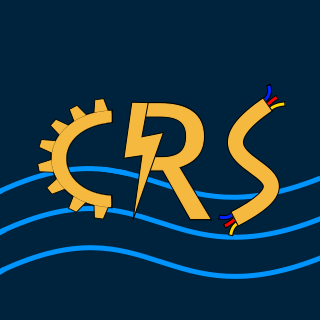

# GCU Robotics Society Github

<div align="center">

</div>

This is the official repository for the Caledonian Robotics Society. This society was started on 22nd of October 2024. This repository contains the official CAD and code resources.

## 🔎 Table of Contents
- [Teams](#teams)
- [Filetree](#filetree)
- [Adding Code](#addingcode)

## Teams

There are 3 teams in the Caledonian Robotics Society
- Autonomous Sumo
- Remote Controlled Sumo
- Line Follower

## Filetree

The Files have the following structure:  *(update when needed)*

``` 
main
├── Assets
│   └── Logo.png
├── ExampleCode
│   ├── BT_RECEIVER.ino
│   └── MAC_adress_finder.ino
├── README.md
└── Teams
    ├── AutoSumo
    │   └── V1.0
    │       ├── Basic_Working.ino
    │       ├── Motor_Functions.ino
    │       ├── Motor_Movement.ino
    │       ├── Responsive_Forward_Backward.ino
    │       └── Ultrasionic_code.ino
    ├── LineFollower
    │   └── V1.0
    │       └── temp.txt
    └── ManualSumo
        └── V1.0
            ├── Analog_Joystick.ino
            ├── BT_RECEIVER_MOTORS.ino
            └── Joystick_Sensing.ino
```

## Adding Code

Due to the nature of this repo a pull request rule has been added. Essentially meaning that when you add a file a personal branch of the project will be made which you can update all you want, and a pull request will be made. This in essence means you are requesting changes, these will be reviewed by the admins and (hopefully) be accepted and applied to the main branch. This is to ensure no "bad actors" break the code, we hope you understand.

### Last Updated 20/11/26
